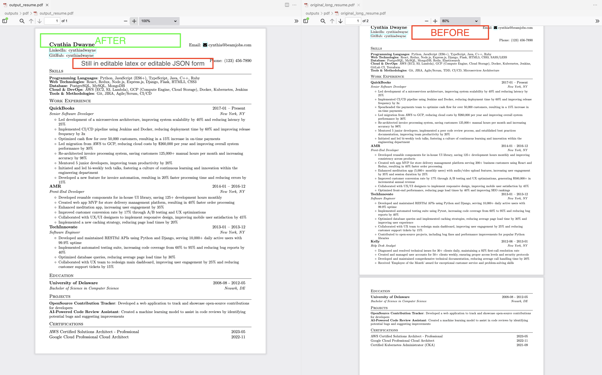

# Mid-Life Agent (*Agente da Meia Idade*)

🇧🇷 [Leia em português](README.pt-BR.md)


A multi-agent AI team that repositions your résumé for each job you apply to.
It was built by a 30-year IT veteran to get back into the job market, and it worked:
**5 months later, he was hired.** Now it is open source so it can help you too.

A *Career Strategist*, a *Hiring Manager*, a *Resume Editor* and a *Job Applicant* agent
(built on [CrewAI](https://docs.crewai.com)) iterate until the résumé scores ≥ 8.5 against the target job.



## Highlights

- **No invented facts.** The AI only selects and rephrases what is in your sources; your
  `profile_truth.md` overrides everything else.
- **One résumé per job.** Paste a job description, get a tailored JSON + LaTeX + PDF.
- **Multi-LLM:** OpenAI, Anthropic, Gemini, Grok (xAI) or AWS Bedrock.
- **Multi-person:** data is isolated per person (`input/<person>/`, `data/<person>/`, `outputs/<person>/`).
- **Bilingual output:** `--lang pt-BR` (default) or `--lang en`.
- **Full career coverage:** every position is kept, newest first; no fixed bullet or page limit.

## ⚠️ Privacy first

Your résumé is personal data. During generation, your files are **sent to the LLM provider you configure**.

- `input/`, `data/` and `outputs/` are git-ignored on purpose. **Never commit them or publish your fork's outputs.**
- Put API keys only in `.env` (git-ignored). For Bedrock, use an AWS CLI profile, never keys in files.
- Do not write into `profile_truth.md` anything you are not comfortable sending to your provider.

## How it works

```
input/<you>/  PDF/DOCX résumés + profile_truth.md (+ about_me.md)
      │  ingest_resume.py
      ▼
data/<you>/resume.json   ← canonical source (never overwritten)
      │  + job description
      ▼
agents (strategist → hiring manager → editor → applicant) ─ loop until score ≥ 8.5
      ▼
outputs/<you>/<role>/{json,latex,pdf}
```

## Quick start

Requirements: Python 3.12, a LaTeX distribution (for PDF), and an API key for one provider.

```bash
git clone <this-repo> && cd mid-life-agent
pip install -r requirements.txt
cp .env.example .env            # set LLM_PROVIDER and your key

# Try the fictional example (Jane Doe)
mkdir -p input/jane_doe data/jane_doe/job_profiles
cp examples/jane_doe/profile_truth.md examples/jane_doe/job_desc.md input/jane_doe/
cp examples/jane_doe/resume.json data/jane_doe/
cp examples/jane_doe/job_profiles/*.txt data/jane_doe/job_profiles/

python main.py --person jane_doe --job --lang en
```

### With your own data

1. Create `input/<you>/` and drop your current résumés (PDF/DOCX) there.
2. Copy `examples/jane_doe/profile_truth.md` to `input/<you>/` and fill it in. This is your guardrail.
   (A good way: have an AI interview you and save the transcript as `input/<you>/about_me.md`.)
3. Generate your base JSON: `python -m src.scripts.ingest_resume --person <you>`
4. Save a job description as `input/<you>/job_desc.md` and run `python main.py --person <you> --job`
5. Find results in `outputs/<you>/<role>/`.

Other commands: `--role <name>` (profile in `data/<you>/job_profiles/<name>.txt`), `--all`,
`--provider <openai|anthropic|gemini|grok|bedrock>`, `--list-roles`, `--list-people`,
`python src/scripts/run_compare_pdf.py` (GitHub-style diff vs. the original).

## AWS Bedrock

```dotenv
LLM_PROVIDER=bedrock
AWS_PROFILE=mid-life-agent
AWS_DEFAULT_REGION=us-east-1
BEDROCK_MODEL_ID=us.anthropic.claude-opus-4-6-v1
BEDROCK_FALLBACK_MODEL_ID=us.anthropic.claude-sonnet-4-6   # empty disables fallback
BEDROCK_EXTRACTION_MODEL_ID=deepseek.v3.2
BEDROCK_MAX_TOKENS=16384
```

Create a restricted AWS CLI profile and adapt [infra/aws/bedrock-policy.json](infra/aws/bedrock-policy.json)
(replace `123456789012` with your account ID). Retries and the single Sonnet fallback apply only to
throttling/unavailability; permission and validation errors are propagated. Offline tests:
`python -m unittest discover -s tests -v`.

## Contributing

See [CONTRIBUTING.md](CONTRIBUTING.md). Never include real personal data in issues or PRs.

## License & credits

MIT. Based on the original project by Rushi Chaudhari ([0xrushi](https://github.com/0xrushi)); see [LICENSE](LICENSE).
