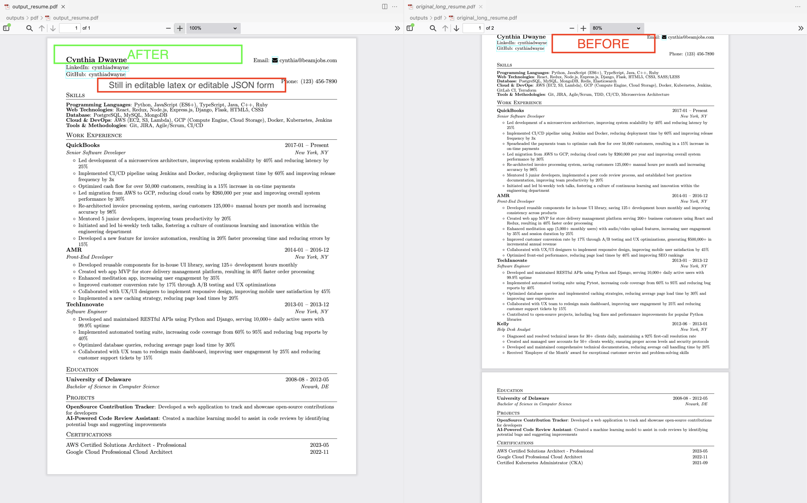

# Agente da Meia Idade

🇬🇧 [Read in English](README.md)


Uma equipe de agentes de IA que reposiciona o seu currículo para cada vaga.
Foi criada por um profissional de TI com 30+ anos de carreira para voltar ao mercado, e funcionou:
**5 meses depois, ele foi contratado.** Agora é código aberto para ajudar você também.

Os agentes *Estrategista de Carreira*, *Gerente de Contratação*, *Editor de Currículo* e *Candidato*
(sobre o [CrewAI](https://docs.crewai.com)) iteram até o currículo atingir nota ≥ 8.5 para a vaga.



## Destaques

- **Sem histórias falsas.** A IA só seleciona e reescreve o que está nas suas fontes; o `profile_truth.md` tem prioridade sobre tudo.
- **Um currículo por vaga:** cole a descrição da vaga e receba JSON + LaTeX + PDF sob medida.
- **Multi-LLM:** OpenAI, Anthropic, Gemini, Grok (xAI) ou AWS Bedrock.
- **Multi-pessoa:** dados isolados por pessoa (`input/`, `data/`, `outputs/`).
- **Saída bilíngue:** `--lang pt-BR` (padrão) ou `--lang en`.
- **Cobertura completa da carreira:** todas as posições são mantidas, da mais recente à mais antiga; sem limite fixo de bullets ou páginas.

## ⚠️ Privacidade em primeiro lugar

Seu currículo é dado pessoal. Durante a geração, os arquivos são **enviados ao provedor de IA configurado**.

- `input/`, `data/` e `outputs/` estão no `.gitignore` de propósito. **Nunca os versione nem publique os resultados.**
- Chaves de API só no `.env` (ignorado pelo git). No Bedrock, use um perfil do AWS CLI.
- Não escreva no `profile_truth.md` nada que você não queira enviar ao provedor.

## Início rápido

Requisitos: Python 3.12, uma distribuição LaTeX (para o PDF) e uma chave de API de um provedor.

```bash
git clone <este-repo> && cd mid-life-agent
pip install -r requirements.txt
cp .env.example .env            # defina LLM_PROVIDER e sua chave

# Teste com o exemplo fictício (Jane Doe)
mkdir -p input/jane_doe data/jane_doe/job_profiles
cp examples/jane_doe/profile_truth.md examples/jane_doe/job_desc.md input/jane_doe/
cp examples/jane_doe/resume.json data/jane_doe/
cp examples/jane_doe/job_profiles/*.txt data/jane_doe/job_profiles/

python main.py --person jane_doe --job --lang en
```

### Com os seus dados

1. Crie `input/<voce>/` e coloque seus currículos atuais (PDF/DOCX).
2. Copie `examples/jane_doe/profile_truth.md` para `input/<voce>/` e preencha. Ele é o seu guardrail.
   (Dica: peça para uma IA entrevistar você e salve a transcrição em `input/<voce>/about_me.md`.)
3. Gere o JSON base: `python -m src.scripts.ingest_resume --person <voce>`
4. Salve a vaga em `input/<voce>/job_desc.md` e rode `python main.py --person <voce> --job`
5. Os resultados ficam em `outputs/<voce>/<cargo>/`.

Outros comandos: `--role <nome>`, `--all`, `--provider`, `--list-roles`, `--list-people`,
`python src/scripts/run_compare_pdf.py` (diff estilo GitHub contra o original).

## AWS Bedrock

Veja a seção equivalente no [README em inglês](README.md#aws-bedrock). Adapte
[infra/aws/bedrock-policy.json](infra/aws/bedrock-policy.json) trocando `123456789012` pelo ID da sua conta.

## Contribuindo e licença

Veja [CONTRIBUTING.md](CONTRIBUTING.md). Licença MIT, baseada no projeto original de Rushi Chaudhari
([0xrushi](https://github.com/0xrushi)); veja [LICENSE](LICENSE).
